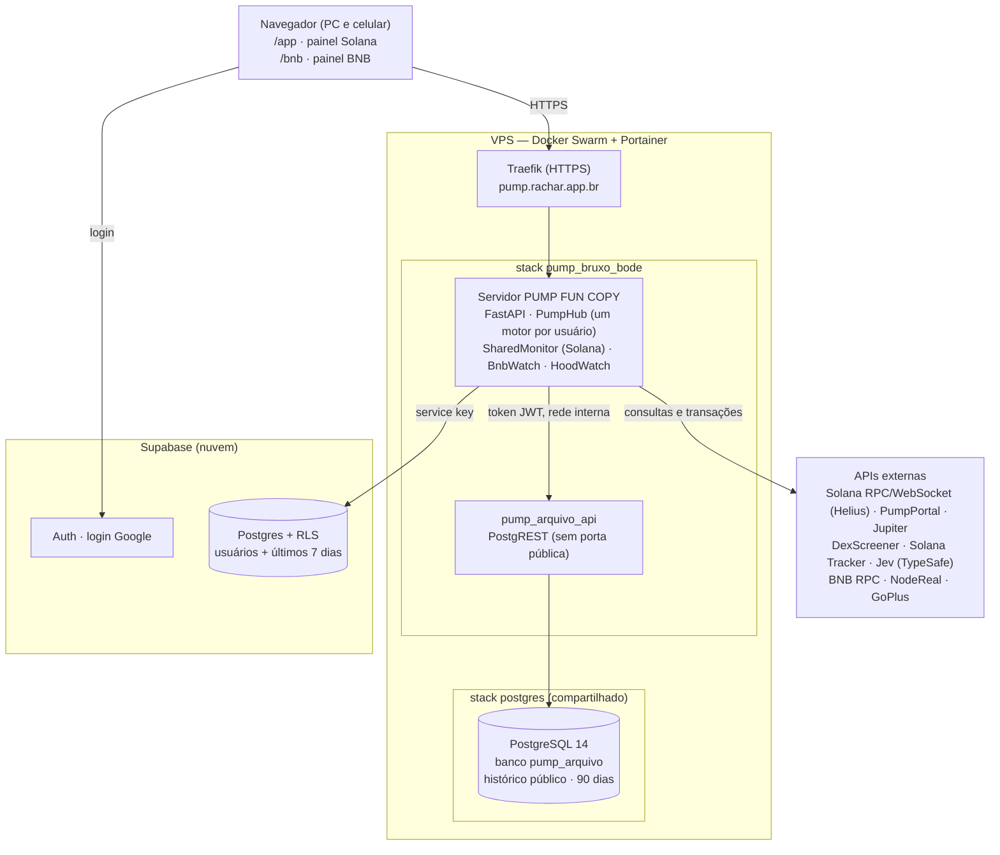
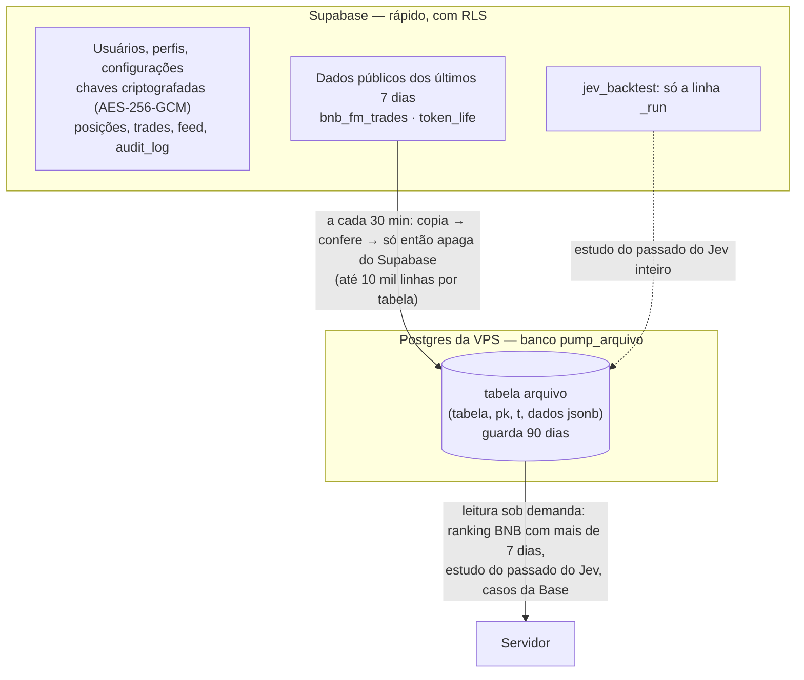
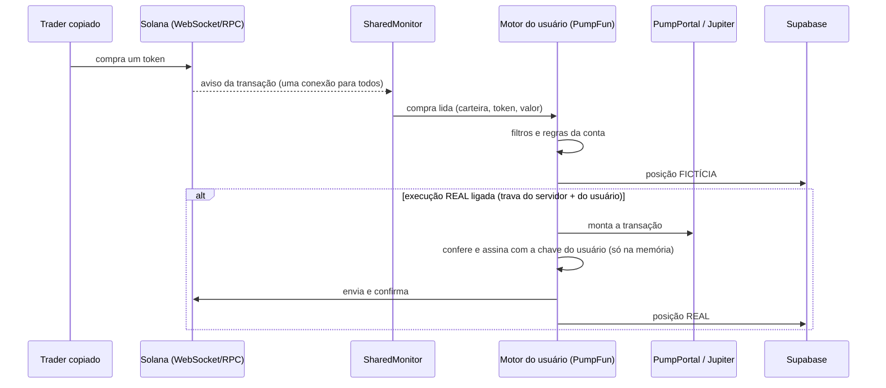

# PUMP FUN COPY — arquitetura e bancos de dados

Atualizado em 05/11/2026 (versão 0.32.227). Visão geral de onde cada parte roda, por onde os dados passam e onde ficam
guardados. Detalhes de cada arquivo e as regras de trabalho estão no `CLAUDE.md`; o uso do painel, no `GUIA-DO-PROJETO.md`.

## 1. Visão geral

- **Servidor (stack `pump_bruxo_bode`)**: um único container com o painel, a API e os robôs. Imagem
  `ghcr.io/bruxo95/pump.fun_bruxo_bode:latest`, publicada pelo GitHub Actions a cada push no `main`; o Portainer
  atualiza pelo webhook. Variáveis no stack (nunca no código): ver `deploy/portainer-stack.yml`.
- **Solana, BNB e Robinhood ficam separados**: cada rede tem o seu laço, as suas tabelas (`bnb_*`, `hood_*`) e o seu
  painel (`/app`, `/bnb`). Tela, chave ou opção da BNB vai no `/bnb`, nunca no `/app`.

## 2. Onde ficam os dados (divisão do banco, desde a 0.32.225)

| Onde | O quê | Por quê |
|---|---|---|
| **Supabase** | Tudo que é de usuário (perfis, configurações, chaves, posições, trades, feed, audit_log) e os dados de consulta rápida dos últimos 7 dias | Tem RLS (cada usuário só vê o que é dele) e login Google |
| **Postgres da VPS** (`pump_arquivo`) | Histórico **público**: trades da BNB e vida dos tokens com mais de 7 dias, estudo do passado do Jev | Tira peso do Supabase; guarda 90 dias |

Regras:
- **Só dado público vai para o arquivo** (lá não existe RLS). Nada de usuário, chave ou posição.
- O servidor **só apaga do Supabase depois de conferir** que a linha chegou ao arquivo. Arquivo fora do ar = nada é
  apagado, e o robô continua operando normal (só o histórico antigo fica indisponível).
- O arquivo guarda **90 dias**: uma vez por dia o que passou disso é apagado.
- Sem `ARQUIVO_URL` + `ARQUIVO_JWT_SECRET` no stack, o arquivo fica desligado e tudo volta a ficar só no Supabase.
- Nada de reler tabela inteira ao reiniciar: cada reinício carrega só a janela usada (ex.: BNB 7 dias); o resto vem
  sob demanda. Muitos deploys seguidos pesam no banco (incidente de 04/11/2026).

### Peças do arquivo

| Peça | Onde | Detalhe |
|---|---|---|
| Banco `pump_arquivo` | stack `postgres` (PostgreSQL 14, rede `vpsrachar`, host `postgres`) | Compartilhado com outros projetos da VPS; o PUMP só usa este banco. Criado uma vez com `deploy/arquivo.sql` |
| Usuários do banco | `pump_arquivo` (papel, sem login) e `pump_arquivo_auth` (login do PostgREST) | Permissões: ler, inserir, atualizar e apagar só na tabela `arquivo` |
| `pump_arquivo_api` | stack `pump_bruxo_bode` | PostgREST v12.2.3, sem porta pública e sem Traefik, sem acesso anônimo: só aceita token assinado com `ARQUIVO_JWT_SECRET` |
| Código | `app/arquivo.py` | `SPECS` (o que vai e com quantos dias), `mover`, `limpa`, `pages`; laço `hub.arquivo_loop` |
| Variáveis do stack | `ARQUIVO_DB_PASSWORD`, `ARQUIVO_JWT_SECRET` | A senha tem que ser a mesma do usuário `pump_arquivo_auth` no banco |
| Acompanhar | Painel → Administração → Status geral | Linhas "Arquivo (Postgres da VPS)" e "Movidas para o arquivo" |

Pendente: backup diário do banco `pump_arquivo` (hoje fica só no disco da VPS).

## 3. Caminho de uma cópia de trade (Solana)

## 4. Entrega

GitHub (`main`) → Actions: testes → migrações do Supabase (`banco`) → imagem no GHCR → webhook do Portainer → o job
confere a versão no `/health`. Mudanças no stack (serviços, variáveis) são feitas pelo dono no Portainer.
