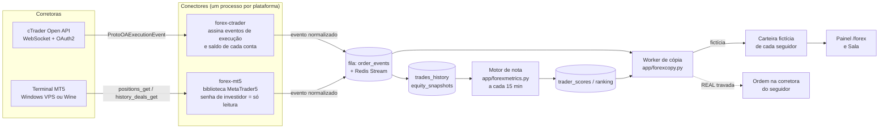

# Projeto Forex — cópia de traders (rede nova do PUMP FUN COPY)

Pedido do dono em 15/11/2026. O projeto vira uma rede nova do PUMP FUN COPY, ao lado de pump.fun, Robinhood e BNB, e segue os mesmos padrões:

- **Visual:** mesmo login Google e mesmo visual; página `/forex` e Sala em `/sala?rede=forex`.
- **Chaves:** as credenciais das corretoras ficam cifradas no Supabase.
- **Execução REAL:** começa desligada. Nesta etapa a cópia é **só fictícia**.

Decisões do dono (15/11/2026):

- **Onde fica:** rede nova no mesmo site.
- **Execução:** só simulada primeiro.
- **Plataforma:** cTrader primeiro.
- **Sala:** só a Sala do painel.

## 1. Divisão dos dados

| Onde | O quê | Por quê |
|---|---|---|
| **Supabase** | `profiles` (login, admin), `forex_contas` (regras da carteira fictícia e de quem copia), credenciais cifradas (`user_secrets`/`app_secrets`, AES-256-GCM com `APP_ENCRYPTION_KEY`), planos/assinaturas (etapa futura) | Dado de usuário, com RLS; a chave nunca sai do servidor |
| **Postgres local (VPS, banco `pump_forex`, `deploy/forex.sql`)** | `traders_monitored`, `trades_history`, `order_events`, `equity_snapshots`, `trader_scores`, `follower_accounts`, `copy_relations`, `copy_orders`, `corretoras`, `ativos` | O que cresce rápido e o motor lê o tempo todo; não pesa o Supabase |

O banco local guarda só o **nome** do segredo (`cred_ref`), nunca a senha nem o token.

## 2. Fluxo dos dados



1. **Conector:** recebe o evento da corretora e transforma num formato único:
   `{trader, ticket, evento: abriu|modificou|fechou_parcial|fechou, lado, simbolo_base, volume, preco, sl, tp, ocorreu_em}`.
   - Grava em `order_events`, com chave única para não repetir.
   - Avisa o worker por um Redis Stream (`XADD forex:eventos`).
   - Sem Redis, o worker lê `order_events` a cada 500 ms (`id > último lido`).
2. **Worker de cópia** (`ForexCopier.on_event`), para cada relação ativa do mestre:
   - descarta evento velho (`atraso_max_s`), símbolo fora da lista e mestre não elegível;
   - calcula o lote (seção 4) e confere a margem do seguidor;
   - na fictícia, abre/fecha a posição na carteira do usuário ao preço do mestre, mais o slippage simulado em pips;
   - na REAL (etapa futura), manda a ordem na corretora do seguidor com `slippage_max_pips`. Se a corretora recusar por preço (requote), tenta de novo até 2 vezes com o preço novo, desde que continue dentro do limite. Se recusar por margem, não tenta de novo e registra o motivo;
   - grava o resultado em `copy_orders` (`unique(relation, ticket, evento, hora)`, o que garante que nada seja executado duas vezes).
3. **Fechamento:**
   - o mestre fecha → o seguidor fecha a mesma posição;
   - o mestre fecha uma parte → o seguidor fecha a mesma fração;
   - o mestre muda SL/TP → o seguidor copia, se `copiar_sl_tp`.
4. **Motor de nota:** a cada 15 min recalcula a nota de cada mestre e grava em `trader_scores`; a view `ranking` pega a mais nova.

Por que um worker em Python com asyncio, e não Celery: o projeto todo já é Python/FastAPI. Os eventos chegam por WebSocket (cTrader) ou consulta frequente (MT5), e um loop assíncrono atende centenas de contas com atraso de milissegundos. O Celery faz sentido quando o processamento é pesado e precisa de várias máquinas; aqui o trabalho por evento é pequeno. O Redis entra só como fila entre o conector e o worker, para eles poderem rodar em containers separados.

## 3. Conectividade (grátis ou barata)

- **cTrader Open API (primeira):**
  - **Cadastro:** gratuita. Cadastra-se um aplicativo em openapi.ctrader.com e o seguidor ou mestre autoriza pelo OAuth2 (login na conta cTrader dele, sem passar senha para nós).
  - **Conexão:** a conexão é TCP/WebSocket com mensagens Protobuf (`ProtoOAApplicationAuthReq` → `ProtoOAAccountAuthReq` → assinatura de `ProtoOAExecutionEvent` e `ProtoOASpotEvent`).
  - **Dados úteis:** o tipo de conta (real/demo) vem em `isLive`. A história vem em `ProtoOADealListReq`.
  - **Tokens:** o `access_token`/`refresh_token` de cada conta fica cifrado no Supabase.
  - **Pendente do dono:** cadastrar o aplicativo e colar Client ID e Client Secret no painel.
- **MT5 (etapa seguinte):**
  - **Biblioteca:** a biblioteca Python `MetaTrader5` só roda no Windows, ao lado de um terminal MT5 aberto.
  - **Infraestrutura:** precisa de um Windows VPS, ou um container com Wine rodando o terminal. Cada terminal fica logado numa conta.
  - **Mestres:** usam a **senha de investidor** (só leitura). O microserviço lê `positions_get()` e `history_deals_get()` a cada 500 ms e manda as diferenças como eventos.
  - **Custo:** é o caminho mais caro (um terminal por conta) e por isso fica depois.
- **Cotações para conferir preço:**
  - **Twelve Data:** plano grátis de cerca de 800 consultas por dia e 8 por minuto (números de memória: conferir no site deles antes de usar). Serve para conferir o preço de entrada do mestre e o slippage simulado.
  - **Preço de mercado sem custo:** o `ProtoOASpotEvent` do próprio cTrader já dá o preço, então a Twelve Data é só uma segunda opinião.

## 4. Lote proporcional (`app/forexcopy.py`)

- **equity** (padrão): `lote = lote_mestre × (patrimônio seguidor ÷ patrimônio mestre) × multiplicador`. Exemplo: mestre com $10.000 e seguidor com $1.000 dá lote 10× menor.
- **multiplicador:** `lote = lote_mestre × multiplicador`.
- **fixo:** `lote = lote_fixo`, sempre.

Depois do cálculo, o lote é arredondado **para baixo** no passo da corretora (`lote_passo`) e limitado por `lote_max` da relação e da corretora. Se der menos que `lote_min`, a ordem é **ignorada** com o motivo "lote abaixo do mínimo"; não arredonda para cima, o que aumentaria o risco do seguidor.

## 5. Nota do trader (`app/forexmetrics.py`)

| Métrica | Como | Por quê |
|---|---|---|
| Max Drawdown | maior queda % do pico ao vale da curva de **patrimônio** (descontando depósitos/saques); sem curva, a de saldo pelos trades | Mede o pior momento que quem copia teria passado |
| Profit Factor | lucro bruto ÷ prejuízo bruto dos trades fechados | Acima de 1,3 é saudável; acima de 5 com poucos trades costuma ser sorte |
| Sharpe | média ÷ desvio dos retornos **diários**, × √252 | Retorno por risco |
| Consistência | fração de semanas positivas, ponderada pelo tamanho da semana | Pega quem ganhou tudo numa semana só |
| Sinal de martingale | fração das perdas seguidas de um lote ≥ 1,5× maior no mesmo símbolo | Martingale ganha sempre até quebrar a conta |
| Sinal de grade | fração do tempo com 4+ posições no mesmo símbolo e mesmo lado, sem stop | Grade sem stop esconde o prejuízo flutuante |

**Filtros (não entra no ranking):**
- conta demo;
- menos de 60 dias de histórico;
- menos de 50 trades fechados;
- drawdown máximo > 40%;
- sinal de martingale ≥ 0,25;
- sinal de grade ≥ 0,25;
- 70%+ dos trades sem stop.

**Nota composta (0–100):**

```
nota = 30 × retorno ajustado ao DD   (retorno anualizado ÷ max DD, 3,0 = nota cheia)
     + 20 × profit factor            (1,0 → 0; 2,5 ou mais → cheio)
     + 20 × consistência             (0..1)
     + 15 × Sharpe                   (0 → 0; 2,0 ou mais → cheio)
     + 15 × histórico                (60 dias → 0; 365 dias → cheio)
     − 40 × sinal de martingale − 40 × sinal de grade   (no mínimo 0)
```

A nota favorece retorno constante com rebaixamento baixo. Quem dobrou a conta com 60% de drawdown fica abaixo de quem fez 25% no ano com 5%.

## 6. Etapas

1. **0.32.368 (esta):** SQL do banco local, este documento, motor de nota e de cópia fictícia (com testes), página `/forex` e Sala. Sem corretora conectada, as telas mostram "nenhum mestre conectado".
2. **Conector cTrader:** OAuth2, eventos ao vivo, histórico, curva de patrimônio e gravação no Postgres local. Ranking com dados reais.
3. **Cópia fictícia ao vivo:** os eventos dos mestres vão para a carteira fictícia dos seguidores. Mede o atraso e o slippage de cada mestre.
4. **MT5** (Windows VPS ou Wine) e **Twelve Data** para conferir preços.
5. **Cópia REAL:** só depois de semanas de fictícia e com teste em conta demo. Atrás da trava geral e da chave de cada usuário, como na Solana.

## 7. Riscos e cuidados

- **Regulação:** copiar ordens de terceiros na conta de outras pessoas, sobretudo cobrando por isso, pode ser atividade regulada (na UE, por exemplo, gestão de carteira ou consultoria pela MiFID II). Antes de abrir para pessoas de fora, vale ouvir um advogado. Não é recomendação jurídica.
- **Execução:** forex com alavancagem perde dinheiro rápido. Atraso de 1 s ou slippage de 2 pips muda o resultado de estratégias de escalpe; o fictício mede isso antes.
- **Credenciais:** OAuth2 do cTrader (sem senha) e senha de investidor do MT5 (só leitura) nos mestres. A senha de negociação do seguidor só na etapa REAL, cifrada, nunca no log.
